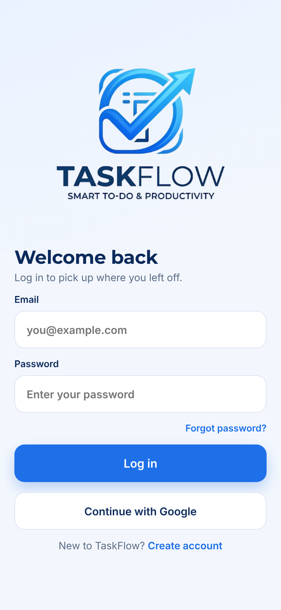
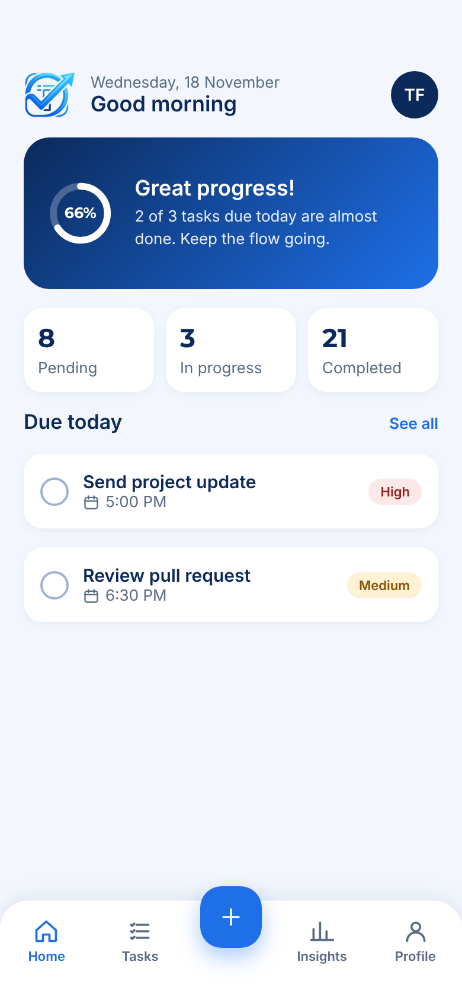
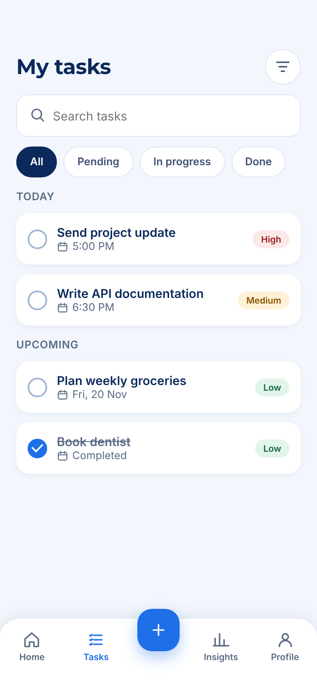
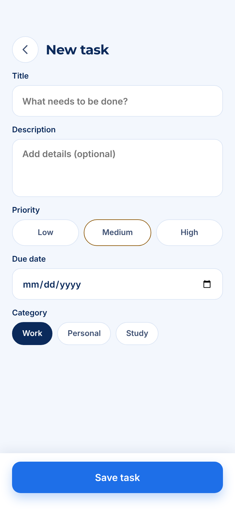

# TaskFlow – UI Design

Mobile-first UI design for TaskFlow, a smart to-do and productivity app (Angular + Fastify + MySQL).

## Screens

### Login

### Dashboard

### Task List

### Add Task

## Links
- Clickable prototype: [Prototype/index.html](/Design/Prototype/index.html)
- PDF: [TaskFlow-UI-Design.pdf](/Design/TaskFlow-UI-Design.pdf)
- Figma: add link here

## User flow
Login → Dashboard → Task List → Add Task → Task List

## Design system
- Colors: Navy `#0B2A5B`, Brand Blue `#1E6FE8`, Sky Blue `#2B8CFF`, Mist `#F3F7FD`, Slate `#5B6B85`
- Fonts: Montserrat Bold (headings), Inter (body)
- Radius / spacing: 14–16 px corners, 20 px padding, 48 px touch targets
